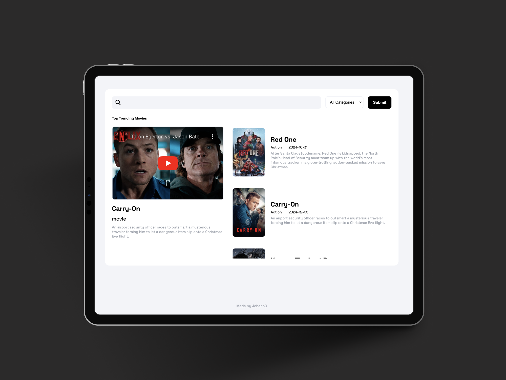

# MovieSpot

MovieSpot is a web application that allows users to search for movies. By entering a search term, the app will return a list of movies that match the query. The backend is built with **Express.js** and **Request** (a Node.js library), while the frontend is developed with **HTML**, **CSS**, and **JavaScript**.

&nbsp;

## 🛠 Technologies

- **Backend:**

  - Express.js
  - Request (Node.js library)

- **Frontend:**
  - HTML
  - CSS
  - JavaScript

&nbsp;

## 📖 CDN Libraries

- Google Fonts

&nbsp;

## ⭐️ Acknowledgments

I would like to thank [TMDb (The Movie Database)](https://www.themoviedb.org/) for providing a free API that allows access to a wealth of data on movies, TV shows, and more. Their platform is essential to this project.

If you're interested in using the API, you can find more information and obtain your own API key on their [website](https://www.themoviedb.org/documentation/api).

&nbsp;

## 🚀 Deployment

To deploy this project, [click here.](https://moviespot-mseu.onrender.com/)

&nbsp;

## 📸 Screen Shot

&nbsp;

## Author

- [@Johanh0](https://www.github.com/johanh0)

## Support or Contact

For support or if you wish to contact me, feel free to email me at [johanherrera20000@gmail.com](mailto:johanherrera20000@gmail.com).

You can also reach out to me via [LinkedIn](https://www.linkedin.com/in/johanh0/).

## License

This project is licensed under the MIT License - see the [LICENSE](LICENSE) file for details.

> **Non-Commercial Use**: This project is not intended for commercial use. Commercial use is prohibited unless explicit permission is granted by the author.

This project uses data from the [TMDb (The Movie Database) API](https://www.themoviedb.org/), which is subject to [TMDb's Terms of Service](https://www.themoviedb.org/terms-of-use).
